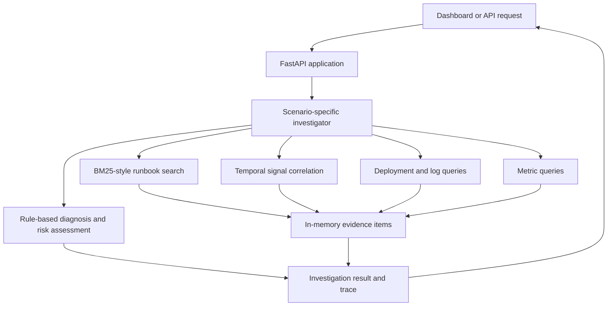

<div align="center">

# AI Incident Investigator

**A local incident-triage demo that correlates synthetic telemetry, retrieves operational runbooks, and explains its findings with linked evidence.**

[](https://www.python.org/)
[](https://fastapi.tiangolo.com/)
[](https://github.com/kanimozhiraja14/Ai_investigator)
[](#safety-and-limitations)

[Quick start](#quick-start) · [Capabilities](#what-it-does) · [API](#api-at-a-glance) · [Safety and limitations](#safety-and-limitations)

</div>

---

> **Audit:** This repository's verified pipeline, test results, and deployment limitations are documented in [`docs/FINAL_QA_REPORT.md`](docs/FINAL_QA_REPORT.md) and [`docs/DEPLOYMENT_READINESS.md`](docs/DEPLOYMENT_READINESS.md).

## What it is

AI Incident Investigator is a Python web application for exploring a set of **10 bundled, synthetic service incidents**. It provides a dashboard and REST API to inspect incident records, query their sample logs, metrics, and deployment events, search Markdown runbooks, and generate a deterministic investigation report.

The investigator follows scenario-specific rules over the bundled data. It is **not a large language model**, does not connect to live observability systems, and does not execute remediation. Its purpose is to demonstrate an incident-triage workflow and make the inputs and evidence used by each report inspectable.

## What it does

- **Investigates sample incidents:** Runs a multi-step, rule-based investigation and returns a proposed diagnosis, category, confidence breakdown, recommendations, risk metadata, and a trace.
- **Correlates sample signals:** Places deployment events, error logs, and selected metric anomalies on a chronological incident timeline.
- **Searches operational runbooks:** Ranks the included Markdown runbooks using BM25-style term scoring with a service-name boost.
- **Links findings to evidence:** Returns evidence items associated with retrieved runbooks, logs, metrics, deployments, and risk assessment. Evidence is held in an in-memory registry during an investigation.
- **Compares against a keyword baseline:** Runs both the investigator and a simpler baseline over the bundled scenarios and reports the project's heuristic evaluation.
- **Provides a browser dashboard:** Serves a static dashboard alongside the API.

## How an investigation works



The data source is the application's in-memory sample telemetry and the runbook files in [`incident_investigator/app/runbooks/`](incident_investigator/app/runbooks/). No external database, model provider, or observability account is required.

## Quick start

### Requirements

- Python 3.10 or newer
- Git

The Docker image uses Python 3.12.

### Install and run

```console
git clone https://github.com/kanimozhiraja14/Ai_investigator.git
cd Ai_investigator
python -m venv .venv
```

Activate the virtual environment:

```powershell
# Windows PowerShell
.\.venv\Scripts\Activate.ps1
```

```bash
# macOS / Linux
source .venv/bin/activate
```

Install dependencies and start the application. By default, the app is in local development mode and should remain bound to loopback:

```console
python -m pip install -r requirements.txt
python -m uvicorn incident_investigator.app.main:app --host 127.0.0.1 --port 8000 --no-access-log
```

Open:

- **Dashboard:** [http://localhost:8000](http://localhost:8000)
- **Interactive API docs:** [http://localhost:8000/docs](http://localhost:8000/docs)
- **ReDoc:** [http://localhost:8000/redoc](http://localhost:8000/redoc)
- **Unauthenticated liveness:** [http://localhost:8000/api/healthz](http://localhost:8000/api/healthz)
- **Authenticated component health:** [http://localhost:8000/api/health](http://localhost:8000/api/health)

To stop the server, press `Ctrl+C`.

### Enable API authentication

When `AI_INVESTIGATOR_API_TOKEN` is configured, every `/api/*` endpoint except the generic `/api/healthz` and `/api/readyz` probes requires `Authorization: Bearer <token>`. The dashboard prompts for the token when needed and holds it in memory only; re-enter it after reloading the page. Production startup requires a token of at least 32 ASCII characters.

For local testing in PowerShell, generate a temporary token without printing it and start the app in the same shell:

```powershell
$env:AI_INVESTIGATOR_API_TOKEN = python -c "import secrets; print(secrets.token_urlsafe(48))"
python -m uvicorn incident_investigator.app.main:app --host 127.0.0.1 --port 8000 --no-access-log
```

The local Python app does not load `.env` files automatically. `.env.example` lists supported variables; set them in the shell or your process manager. Do not send bearer tokens over untrusted HTTP connections.

### Run with Docker Compose

With Docker Desktop and the Compose plugin installed, set a secret in the current PowerShell session and start the production-configured, loopback-bound container:

```powershell
$env:AI_INVESTIGATOR_API_TOKEN = python -c "import secrets; print(secrets.token_urlsafe(48))"
docker compose up --build
```

Open [http://localhost:8000](http://localhost:8000); the dashboard asks for the token. Stop with `Ctrl+C`, then run `docker compose down`. The container is configured with a read-only root filesystem and no persistent application-data volume. **Docker has not been validated in this environment; see [deployment readiness](docs/DEPLOYMENT_READINESS.md) for the required verification steps.**

## API at a glance

All application endpoints are defined in [`incident_investigator/app/main.py`](incident_investigator/app/main.py). The interactive Swagger page at `/docs` is the most complete, runtime-generated API reference.

| Method | Endpoint | Purpose |
|---|---|---|
| `GET` | `/api/health` | Application health and component status |
| `GET` | `/api/healthz`, `/api/readyz` | Generic liveness/readiness probes; no incident details |
| `GET` | `/api/ops/metrics` | Authenticated aggregate operational counters and durations |
| `GET` | `/api/stats` | Summary counts for the sample incidents |
| `GET` | `/api/incidents` | List incidents; supports `severity`, `status`, `service`, and `search` filters |
| `GET` | `/api/incidents/{incident_id}` | Retrieve a single incident |
| `POST` | `/api/investigate/{incident_id}?mode=ai` | Run the rule-based investigator |
| `POST` | `/api/investigate/{incident_id}?mode=baseline` | Run the keyword baseline |
| `GET` | `/api/trace/{incident_id}` | Return investigation trace and evidence chain |
| `GET` | `/api/evidence` | Return evidence for an investigation (defaults to `INC-001`) |
| `GET` | `/api/logs?incident_id=INC-001` | Query sample logs |
| `GET` | `/api/metrics?incident_id=INC-001` | Query sample metric points |
| `GET` | `/api/deployments?incident_id=INC-001` | Query sample deployment events |
| `GET` | `/api/runbooks?query=connection%20pool` | Search the runbook corpus |
| `GET` | `/api/runbooks/{runbook_id}` | Retrieve a runbook |
| `GET` | `/api/benchmark` | Run the comparative benchmark in memory |
| `GET` | `/api/benchmark/export` | Generate and download benchmark JSON in memory |

Example:

```powershell
$headers = @{ Authorization = "Bearer $env:AI_INVESTIGATOR_API_TOKEN" }
Invoke-RestMethod -Headers $headers -Method Post "http://localhost:8000/api/investigate/INC-001?mode=ai"
```

## Benchmark

The checked-in [`benchmark_results.json`](benchmark_results.json) is a snapshot produced by the project's benchmark code over the **10 bundled scenarios**. That snapshot reports 100% investigator accuracy and 0% baseline accuracy, as determined by the project's text-matching correctness heuristic.

Treat these as demo results, not a production accuracy or performance claim:

- The scenarios and their expected causes are bundled test data.
- The investigator uses deterministic, scenario-specific rules; it is not an independently trained or evaluated AI model.
- The correctness metric is a project-defined heuristic, not a human-reviewed assessment.
- Runtime values depend on the machine and measurement conditions; the stored snapshot is not a latency service-level objective.
- Calling `/api/benchmark` computes the report in memory and does not update the checked-in JSON snapshot.

## Safety and limitations

- **Read-only by design:** Investigation tools query data and produce recommendations; they do not carry out remediation. A separate remediation-action method rejects mutation requests, and tests cover selected forbidden inputs. This guard is not a general-purpose production security boundary.
- **Synthetic, in-memory data:** The included incident telemetry is loaded by the application; there are no live integrations, persistent telemetry storage, or multi-user state management.
- **Rule-based diagnosis:** Findings are generated by explicit matching rules in the investigator code. Results should not be interpreted as general-purpose AI reasoning or as validated conclusions for real incidents.
- **Recommendations require review:** Runbook actions and risk metadata are suggestions for this demo. Verify any operational change independently and follow your organization's incident process.
- **Baseline hardening is not production certification:** A shared bearer token, configurable exact-origin CORS, per-process rate limiting, redacted request logs, and aggregate operational metrics are implemented. There is no user identity/RBAC, HTTPS termination, distributed rate limiting, external alerting, real-data redaction, durable evidence storage, or verified Docker runtime. Keep the service on loopback and use only synthetic data; see [security review](docs/SECURITY_REVIEW.md) and [deployment readiness](docs/DEPLOYMENT_READINESS.md).

## Development and tests

Run the automated test suite from the repository root:

```console
python -m unittest discover -s tests -v
```

The suite covers API behavior, investigation results, runbook retrieval, temporal correlation, benchmark generation, and selected read-only guard cases.

## Repository map

```text
incident_investigator/
  app/
    main.py                 FastAPI routes and dashboard serving
    investigator.py         Rule-based investigation flow
    baseline.py             Keyword baseline
    telemetry.py            In-memory sample incidents and telemetry
    correlation_engine.py   Timeline correlation
    runbook_retriever.py    Markdown runbook search
    tools.py                Investigation tools and read-only checks
    runbooks/               Sample operational runbooks
    static/                 Dashboard HTML, CSS, and JavaScript
tests/                      unittest test suite
docs/                       Project design, testing, and deployment notes
benchmark_results.json      Benchmark output snapshot
```

## License

No license file is currently included in the repository. Until one is added, all rights remain with the copyright holder; reuse and redistribution are not granted by this README.
