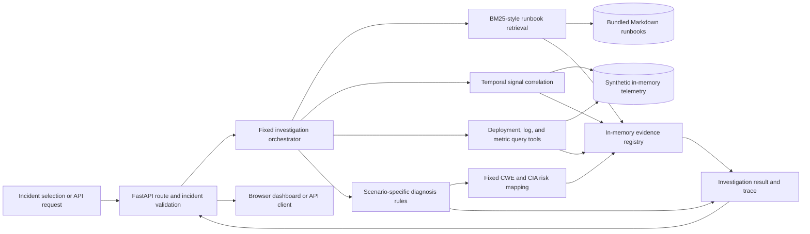
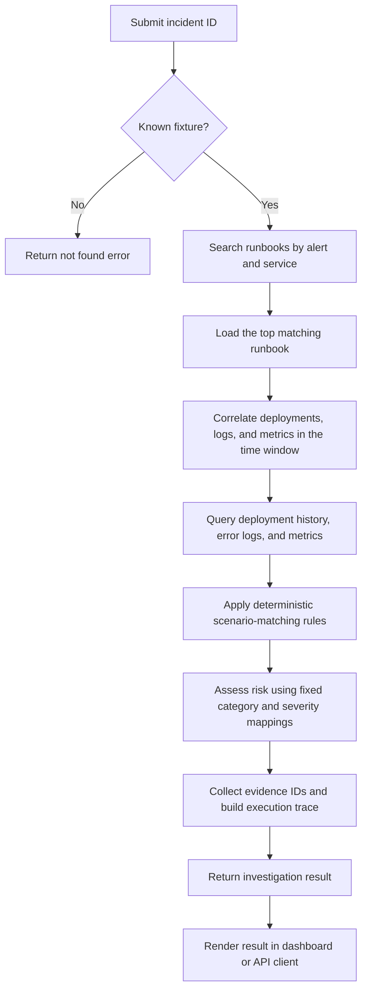

<div align="center">

# AI Incident Investigator

**Evidence-linked incident triage for synthetic SRE and security scenarios.**

A local FastAPI and browser-dashboard demo that retrieves runbooks, correlates fixture telemetry, and produces a traceable, deterministic investigation report.

[](https://www.python.org/)
[](https://fastapi.tiangolo.com/)
[](https://docs.pydantic.dev/)

[Repository](https://github.com/kanimozhiraja14/Ai_investigator) ·
[Audit report](docs/FINAL_QA_REPORT.md) ·
[Security review](docs/SECURITY_REVIEW.md) ·
[Deployment readiness](docs/DEPLOYMENT_READINESS.md)

</div>

> **Project status:** Suitable for a local portfolio demonstration using bundled synthetic data. **Not ready for public deployment or real incident data.** Docker build/runtime validation is blocked because Docker was unavailable during the latest audit.

## Contents

- [Project overview](#project-overview)
- [Capabilities and scope](#capabilities-and-scope)
- [Architecture](#architecture)
- [Investigation workflow](#investigation-workflow)
- [Technology stack](#technology-stack)
- [Project structure](#project-structure)
- [Incident scenarios](#incident-scenarios)
- [Installation and setup](#installation-and-setup)
- [Running the application](#running-the-application)
- [API reference](#api-reference)
- [Dashboard screenshots](#dashboard-screenshots)
- [Testing and evaluation](#testing-and-evaluation)
- [Security architecture](#security-architecture)
- [Deployment readiness](#deployment-readiness)
- [Limitations](#limitations)
- [Roadmap](#roadmap)
- [Contributing and license](#contributing-and-license)
- [Author](#author)

## Project overview

Incident investigation often means manually cross-checking alerts, logs, metrics, deployments, and operational procedures under time pressure. This project demonstrates how those sources can be organized into a repeatable investigation flow with a visible execution trace and references to the records used.

AI Incident Investigator runs against **10 bundled synthetic incidents**. Its deterministic Python logic searches Markdown runbooks, queries in-memory fixture telemetry, correlates timestamps, applies scenario-specific matching rules, and returns a proposed diagnosis with risk metadata and collected evidence.

The “AI” name describes the project's investigation-assistant concept: **the current implementation does not call an LLM or other model provider**. It is intended for portfolio demonstrations, learning, and exercising a small incident-triage API—not for diagnosing live production systems.

## Capabilities and scope

### Implemented

- **Multi-stage investigation:** A fixed orchestrator invokes the investigation stages and returns a result and execution trace.
- **BM25-style runbook retrieval:** Lexically ranks the 10 bundled Markdown runbooks and boosts exact service matches. It does not use embeddings or vector search.
- **Temporal signal correlation:** Filters fixture deployments, logs, and metrics around an incident start time, normalizes timestamps to UTC, and sorts timeline events.
- **Six read-only investigation tool categories:** Runbook search, signal correlation, deployment lookup, log query, metric query, and security-risk assessment. The orchestrator invokes these as a fixed workflow; it does not dynamically select tools using an LLM.
- **Evidence chain:** Assigns evidence IDs to runbook, correlation, deployment, log, metric, and risk records and includes references in the trace. Evidence is process-local and mutable, not an immutable or tamper-evident ledger.
- **CWE and CIA risk metadata:** Applies fixed mappings from fixture incident categories and severity; these mappings are not independently validated risk predictions.
- **Rule-based diagnosis:** Matches the bundled scenario signals to explicit diagnosis rules. The confidence value is a heuristic score, not a statistically calibrated probability.
- **Investigation trace:** Returns the invoked tool names, arguments, result summaries, timestamps, and evidence references.
- **Comparative benchmark:** Compares the investigator and a keyword-search baseline over the same bundled fixtures using the project's text-matching heuristic.
- **FastAPI API and static web dashboard:** Supports incident browsing, investigation, evidence inspection, risk analysis, benchmark results, and operational status.

### Not implemented

There is no live telemetry connector, persistent incident/evidence database, LLM integration, embedding-based retrieval, external remediation, user identity system, or multi-tenant authorization.

## Architecture

The investigation stages below follow the current `AIIncidentInvestigator` orchestration order. The evidence store is in-memory; arrows indicate data flow and references, not independent proof that every diagnosis claim is correct.



The dashboard and API are served by the same FastAPI application. Fixture incidents and telemetry are defined in [`telemetry.py`](incident_investigator/app/telemetry.py); runbooks are read from [`app/runbooks/`](incident_investigator/app/runbooks/).

## Investigation workflow



1. **Validate input:** The API checks that the incident ID exists in the fixture store.
2. **Retrieve procedure context:** Search terms from the alert and service name rank the local runbook corpus; the top match is loaded for the investigation.
3. **Correlate time-window signals:** Deployments, logs, and metrics around the incident start time are filtered and placed on a UTC-ordered timeline.
4. **Query evidence:** The orchestrator separately gathers deployments, error/fatal logs, and metric samples through read-only fixture tools.
5. **Select a diagnosis:** Explicit matching rules inspect the collected fixture signals and select a scenario category and hypothesis. A fallback is used if no rule matches.
6. **Assess risk and assemble output:** Fixed CWE/CIA mappings produce risk metadata; collected evidence and the six orchestration steps are returned with the result.

The “unsupported claims” field is generated by the current rule path; it is **not** an independent claim-to-evidence validator.

## Technology stack

| Technology | Purpose | Usage in project |
|---|---|---|
| Python 3.12 | Application runtime | Docker base image and the audited local environment. `requirements.txt` does not declare a formal supported Python range. |
| FastAPI | HTTP API and application lifecycle | Routes, request validation, OpenAPI/Swagger, ReDoc, middleware, and serving the dashboard. |
| Pydantic 2 | Data models and response serialization | Incident, telemetry, runbook, evidence, risk, investigation, and benchmark models. |
| Uvicorn | ASGI server | Runs the FastAPI application locally and in the container configuration. |
| `httpx` | HTTP test client dependency | Used by the FastAPI/Starlette test setup. |
| BM25-style Python implementation | Lexical retrieval | Custom tokenization, document frequency, BM25 scoring, and service-name boost over Markdown files; no vector database. |
| HTML, CSS, vanilla JavaScript | Browser UI | Static dashboard assets served from `incident_investigator/app/static/`. |
| Dockerfile and Docker Compose | Optional container packaging | Hardened configuration exists, but build and runtime behavior have not been validated because Docker was unavailable. |

Dependency minimums are listed in [`requirements.txt`](requirements.txt); they are not pinned to a lock file.

## Project structure

```text
.
├── incident_investigator/
│   ├── app/
│   │   ├── runbooks/                 10 bundled Markdown runbooks
│   │   ├── static/                   Dashboard HTML, CSS, and JavaScript
│   │   ├── baseline.py               Keyword-search comparison baseline
│   │   ├── benchmark.py              Fixture benchmark and heuristic evaluator
│   │   ├── config.py                 Environment and production config validation
│   │   ├── correlation_engine.py     UTC time-window signal correlation
│   │   ├── investigator.py           Fixed multi-stage investigation flow
│   │   ├── main.py                   FastAPI app, routes, auth, middleware
│   │   ├── models.py                 Pydantic request/result data models
│   │   ├── runbook_retriever.py      Markdown parsing and BM25-style ranking
│   │   ├── telemetry.py              Ten incident and telemetry fixtures
│   │   └── tools.py                  Read-only query, risk, and evidence tools
│   └── run_investigator.py           Command-line demonstration and benchmark
├── tests/                            unittest suite
├── docs/                             Audit, QA, API, architecture, and deployment docs
├── .env.example                      Environment-variable template
├── benchmark_results.json            Checked-in benchmark snapshot
├── docker-compose.yml                Optional container runtime configuration
├── Dockerfile                        Container build definition
├── requirements.txt                  Python dependency ranges
├── TASK_DOCUMENTATION.md             Original project notes (contains stale claims)
└── test_routes.py                    Legacy route-test script
```

The current implementation and audit reports take precedence over the original [`TASK_DOCUMENTATION.md`](TASK_DOCUMENTATION.md), which contains claims that are not supported by the code (including production-readiness and immutability claims).

## Incident scenarios

All scenarios are synthetic and are defined in [`telemetry.py`](incident_investigator/app/telemetry.py). The investigation objective below summarizes the fixture ground-truth cause; it is an evaluation target, not a claim about a real service.

| ID | Incident title | Affected service | Scenario and investigation objective |
|---|---|---|---|
| `INC-001` | Payment Service 500 Spike after Canary Rollout | `payment-service` | Investigate whether a missing `STRIPE_WEBHOOK_SECRET` in deployment `v2.4.1` explains webhook failures after rollout. |
| `INC-002` | Order Service Database Connection Pool Starvation & Timeout Cascade | `order-service` | Determine whether an unindexed analytics query exhausted the 50-slot connection pool and caused timeouts. |
| `INC-003` | Auth Service Host Node Disk Exhaustion (`/var/log` at 100%) | `auth-service` | Trace disk exhaustion to the logrotate permission failure combined with debug logging. |
| `INC-004` | Inventory Service Memory Leak and OOMKilled Container Cascade | `inventory-service` | Investigate whether an unbounded reservation cache without TTL or eviction caused memory pressure and OOM restarts. |
| `INC-005` | Notification Worker Threadpool Starvation via Upstream SendGrid Socket Hang | `notification-service` | Correlate SendGrid socket timeouts with blocked workers and queue growth; inspect the missing timeout/circuit-breaker controls described in the fixture. |
| `INC-006` | Ingress Gateway Edge SSL Certificate Expiration & Handshake Failures | `ingress-gateway` | Determine why certificate renewal failed and whether the expired Cloudflare API token prevented renewal before certificate expiry. |
| `INC-007` | Catalog Service Redis Cache Stampede on Black Friday Hot Key | `catalog-service` | Correlate hot-key expiry, Redis hit-ratio drop, and database pressure; investigate the lack of request coalescing or TTL jitter. |
| `INC-008` | API Gateway False-Positive 429 Rate Limiting via Internal Node IP Flattening | `api-gateway` | Check whether a proxy configuration change removed `real_ip_header` and grouped clients under one internal address. |
| `INC-009` | Billing Consumer Partition Rebalance Loop triggered by Poison Pill Message | `billing-consumer` | Correlate malformed message processing and consumer lag with poll timeouts and repeated group rebalances. |
| `INC-010` | User Profile Service Inter-Service RPC 401s after Vault Key Auto-Rotation | `user-profile-service` | Investigate whether JWT key rotation combined with a stale 24-hour JWKS cache caused authentication failures. |

## Installation and setup

### Requirements

- Git
- Python 3.12 is the container base and the version used in the latest audited local environment. The project does not currently declare a formal minimum Python version.

### Windows PowerShell

```powershell
git clone https://github.com/kanimozhiraja14/Ai_investigator.git
Set-Location Ai_investigator
python -m venv .venv
.\.venv\Scripts\Activate.ps1
python -m pip install -r requirements.txt
```

If PowerShell blocks activation due to the local execution policy, activate only for the current terminal session and retry:

```powershell
Set-ExecutionPolicy -Scope Process -ExecutionPolicy Bypass
.\.venv\Scripts\Activate.ps1
```

The local Python process does **not** load `.env` files automatically. [`.env.example`](.env.example) lists the supported variables; set them in the shell or through a process manager. For a local authenticated run, generate a temporary token in the current PowerShell session:

```powershell
$env:APP_ENV = 'development'
$env:AI_INVESTIGATOR_API_TOKEN = python -c "import secrets; print(secrets.token_urlsafe(48))"
```

PowerShell assigns the generated value without displaying it. The API token is optional in development, but production startup requires one. Do not commit credentials or transmit them over an untrusted HTTP connection.

## Running the application

From the activated environment and repository root:

```powershell
python -m uvicorn incident_investigator.app.main:app --host 127.0.0.1 --port 8000 --no-access-log
```

Open:

- **Dashboard:** [http://127.0.0.1:8000/](http://127.0.0.1:8000/)
- **Swagger UI:** [http://127.0.0.1:8000/docs](http://127.0.0.1:8000/docs)
- **ReDoc:** [http://127.0.0.1:8000/redoc](http://127.0.0.1:8000/redoc)
- **Generic liveness:** [http://127.0.0.1:8000/api/healthz](http://127.0.0.1:8000/api/healthz)
- **Generic readiness:** [http://127.0.0.1:8000/api/readyz](http://127.0.0.1:8000/api/readyz)

When a token is configured, the dashboard prompts for it and keeps it in memory only. Re-enter it after reloading the page. The `/api/healthz` and `/api/readyz` probes remain unauthenticated; other `/api/*` routes require a bearer token when one is configured, and production requires the token at startup.

To run the audited test suite:

```powershell
python -m unittest discover -s tests -v
```

An optional CLI demonstration is available:

```powershell
python -m incident_investigator.run_investigator
```

Stop the server with `Ctrl+C`.

### Optional Docker Compose run

The container configuration is **not runtime-validated**. If Docker Desktop and the Compose plugin are installed, set a token and run:

```powershell
$env:AI_INVESTIGATOR_API_TOKEN = python -c "import secrets; print(secrets.token_urlsafe(48))"
docker compose up --build
```

Compose binds the service to loopback. Docker validation was blocked in the latest audit; follow the [deployment readiness report](docs/DEPLOYMENT_READINESS.md) before relying on this configuration.

## API reference

The live OpenAPI document is served at `/openapi.json`; Swagger UI at `/docs` is the authoritative runtime contract. The table below matches the current route definitions in [`main.py`](incident_investigator/app/main.py).

When `AI_INVESTIGATOR_API_TOKEN` is configured, all listed `/api/*` endpoints require `Authorization: Bearer <token>` except `/api/healthz` and `/api/readyz`. In production, the token is mandatory. There are no request bodies on the current API routes.

| Method | Endpoint | Parameters | Purpose |
|---|---|---|---|
| `GET` | `/api/healthz` | None | Generic liveness response. No incident details. |
| `GET` | `/api/readyz` | None | Readiness check for loaded fixtures and runbooks. |
| `GET` | `/api/health` | None | Detailed process and bundled-component status. |
| `GET` | `/api/ops/metrics` | None | Aggregate request, latency, investigation, and tool-failure counters. |
| `GET` | `/api/stats` | None | Fixture counts by severity, status, and category. |
| `GET` | `/api/incidents` | Optional `severity`, `status`, `service`, `search` | List and filter bundled incidents. |
| `GET` | `/api/incidents/{incident_id}` | Path: `incident_id` | Retrieve one incident fixture; unknown IDs return 404. |
| `GET` | `/api/evidence` | Optional `incident_id`, `source_type`, `search` | Run an investigation (defaults to `INC-001`) and return filtered evidence for that run. |
| `GET` | `/api/logs` | Required `incident_id`; optional `service`, `level`, `search`, `limit` (1–200; default 50) | Query synthetic log records. |
| `GET` | `/api/metrics` | Required `incident_id`; optional `service`, `metric_name` | Query synthetic metric samples. |
| `GET` | `/api/deployments` | Required `incident_id`; optional `service` | Query synthetic deployment events. |
| `GET` | `/api/runbooks` | Required `query`; optional `service` | Search the local Markdown runbooks. |
| `GET` | `/api/runbooks/{runbook_id}` | Path: `runbook_id` | Retrieve parsed runbook content; unknown IDs return 404. |
| `POST` | `/api/investigate/{incident_id}` | Path: `incident_id`; optional query `mode=ai\|baseline` (default `ai`) | Run the multi-stage deterministic investigator or keyword baseline. |
| `GET` | `/api/trace/{incident_id}` | Path: `incident_id` | Run the investigator and return its trace, evidence chain, and result summary. |
| `GET` | `/api/benchmark` | None | Run the comparative fixture benchmark in memory. |
| `GET` | `/api/benchmark/export` | None | Generate a JSON benchmark download in memory; does not update the checked-in snapshot. |

### Investigation request

With the optional local token configured:

```powershell
$headers = @{ Authorization = "Bearer $env:AI_INVESTIGATOR_API_TOKEN" }
$result = Invoke-RestMethod `
  -Method Post `
  -Headers $headers `
  -Uri 'http://127.0.0.1:8000/api/investigate/INC-001?mode=ai'
$result | ConvertTo-Json -Depth 8
```

The endpoint accepts no JSON body. Use `mode=baseline` to run the keyword-search comparator.

### Investigation response excerpt

The result includes a hypothesis, category, heuristic confidence, tool trace, evidence chain, recommended runbook steps, risk metadata, and measured duration. Durations vary by machine and run.

```json
{
  "incident_id": "INC-001",
  "incident_title": "Payment Service 500 Spike after Canary Rollout",
  "mode": "READ_ONLY",
  "root_cause_diagnosis": "Missing environment secret 'STRIPE_WEBHOOK_SECRET' introduced in deployment DEP-101 (v2.4.1) causing unhandled NullPointerException in WebhookHandler.",
  "category": "BAD_DEPLOYMENT",
  "confidence_score": 0.967,
  "steps_count": 6,
  "unsupported_claims": []
}
```

`unsupported_claims` is an output from the investigator's rule path, not an independent audit of every statement. Confidence is a weighted heuristic, not a calibrated probability.

## Dashboard screenshots

No application screenshots are checked into the repository. The dashboard can be viewed locally after setup; the placeholders below are intentional and are **not mock or generated application screenshots**. Capture the real UI at the listed views and save the images under `docs/images/` before replacing each placeholder with a relative Markdown image link.

| View | Screenshot status | Capture target |
|---|---|---|
| Overview dashboard | **Placeholder — capture from a running local app** | Overview with fixture summary cards and incident queue; save as `docs/images/overview.png`. |
| Incident roster | **Placeholder — capture from a running local app** | Roster with its search/filter controls and fixture rows; save as `docs/images/incident-roster.png`. |
| Investigation workspace | **Placeholder — capture from a running local app** | Completed investigation showing diagnosis and tool trace; save as `docs/images/investigation-workspace.png`. |
| Evidence explorer | **Placeholder — capture from a running local app** | Evidence list and a selected evidence detail; save as `docs/images/evidence-explorer.png`. |
| Risk and CWE analysis | **Placeholder — capture from a running local app** | Risk view with CWE and CIA metadata; save as `docs/images/risk-analysis.png`. |
| Execution trace | **Placeholder — capture from a running local app** | Trace view with tool calls and evidence references; save as `docs/images/execution-trace.png`. |

Use the bundled synthetic fixtures only. Do not include real incident details, credentials, or personal data in screenshots.

## Testing and evaluation

### Automated and browser testing

The latest complete post-hardening run recorded in [`docs/FINAL_QA_REPORT.md`](docs/FINAL_QA_REPORT.md) passed **54 tests** with no failures. The tests use Python's standard-library `unittest` runner and cover API routes and validation, investigation results, retrieval, temporal correlation, six tool categories, evidence references, read-only guard behavior, benchmark behavior, and production-hardening controls. The audited run emitted a Starlette/HTTPX deprecation warning; it did not fail the suite.

The QA report also records browser checks of the eight dashboard sections, filters, investigation modes, evidence and trace views, empty/error states, responsive layout, token entry, and hostile telemetry rendering. These are audit results, not a claim that every browser or deployment topology has been tested. Re-run the command from [Running the application](#running-the-application) to verify the current checkout.

### Benchmark methodology and results

The checked-in benchmark uses **10 bundled incidents**. `benchmark.py` applies the same `_evaluate_correctness()` helper to investigator and baseline output. The helper requires at least one key-signal token to match and at least 25% of the ground-truth words to appear in the diagnosis.

The latest audited execution recorded **10/10 investigator matches and 0/10 baseline matches under that project-defined heuristic**. This is not a human-reviewed accuracy score: the diagnosis rules are scenario-specific, the scenarios and expected causes ship together, and there is no independent evaluator. The empty investigator `unsupported_claims` field is likewise not an independent hallucination audit.

Run the benchmark through the API or `python -m incident_investigator.run_investigator`. It evaluates the fixture set in memory; benchmark HTTP routes do not rewrite `benchmark_results.json`. Retrieval testing covered 10 curated alert/service queries, with the expected runbook ranked first for each. This does not estimate retrieval recall over a broader corpus.

### Performance and reproducibility

No post-hardening latency or load test was performed. The diagnosis timers are short, rounded in-process measurements and should not be treated as an SLO or production performance result. The historical API latency samples in the audit predate the authentication, logging, metrics, and rate-limiting middleware.

Fixtures are bundled in source and require no external services. Dependency ranges are not locked, so installations may resolve different package versions over time. Docker build and runtime validation remain blocked; see [Deployment readiness](#deployment-readiness).

## Security architecture

| Control | Current implementation | Boundary or limitation |
|---|---|---|
| Read-only investigation | Tools query only the bundled in-memory fixtures; no infrastructure remediation integration exists. A remediation method rejects calls, and a lexical guard rejects selected mutation-like terms. | The lexical guard is input filtering, **not** a sandbox or security boundary. |
| API authentication | Optional shared bearer token in development; required and validated at production startup. Protected API routes use constant-time token comparison. | No per-user identity, roles, expiry, issuance, or revocation; every token holder has the same access. |
| CORS | Exact configured origins; wildcard origins are rejected; credentials are disabled; production allowlist origins must use HTTPS. | Approved-origin browser deployment was not runtime-tested. |
| Rate limiting | In-memory fixed-window limiter with per-client address tracking and `429` responses. | Process-local only; use gateway-level controls in any network deployment. |
| Logging and errors | Structured application request/error logging omits credentials, request bodies, raw URLs, query strings, and incident payloads. Unexpected errors return generic responses with request IDs. | Infrastructure and reverse-proxy logs require their own redaction and retention policy. |
| Monitoring | Authenticated aggregate `/api/ops/metrics`; generic liveness/readiness probes. | Counters are volatile and local; no external monitoring, alerting, or durable metrics backend. |
| Evidence | Evidence IDs and trace references connect returned items to fixture records. | In-memory and mutable; not cryptographically hashed, durable, or independently claim-verified. |
| Configuration | Production validates token presence/format, CORS origins, and rate-limit settings; `.env.example` contains placeholders. | Local Python does not load `.env` automatically. Protect deployment secrets through the process environment or a secret manager. |

See the detailed [security review](docs/SECURITY_REVIEW.md). Do not connect real incident telemetry to this demo.

## Deployment readiness

**Recommendation: suitable for a local portfolio demonstration with documented limitations; not ready for public deployment.**

| Deployment area | Status |
|---|---|
| Local run with bundled synthetic data | **PASS** in the latest audit |
| Baseline bearer authentication and configuration validation | **Implemented and tested**; shared credential only |
| TLS termination and network edge controls | **Not implemented in the app**; required before network exposure |
| Identity, per-user authorization, and revocation | **Outstanding** |
| External monitoring, alerting, durable logs/metrics | **Outstanding** |
| Real-data redaction, retention, persistence, backup/recovery | **Not implemented** |
| Dependency lock and vulnerability scan | **Outstanding / not tested** |
| Docker build and runtime validation | **BLOCKED** — Docker was unavailable in the audit environment |

The Compose file binds to loopback and configures a read-only container filesystem and reduced privileges, but these settings have not been proven by a Docker build/run. The application serves HTTP; it does not terminate TLS. Do not expose port 8000 publicly or use real/sensitive incident data. See [deployment readiness](docs/DEPLOYMENT_READINESS.md) for exact outstanding checks and Docker validation instructions.

## Limitations

- Investigation is deterministic, scenario-specific Python logic—not a general-purpose AI/LLM diagnosis.
- Only the 10 bundled synthetic incidents, their logs/metrics/deployments, and 10 local runbooks are available.
- The investigator invokes tools in a fixed order; there is no autonomous tool planning.
- Runbook search is lexical BM25-style ranking, not semantic or vector search.
- Evidence is process-local, mutable, and not tamper-evident; findings do not have independent claim-level citations.
- CWE/CIA and confidence values are fixed mappings and heuristics, not externally validated security or probability assessments.
- Authentication uses one optional development/shared production token; multi-user identity and RBAC are absent.
- Rate limiting and operational counters are in memory and per process.
- The app has no TLS termination, external monitoring/alerting, real-data redaction/retention, persistence, or backup/recovery workflow.
- Dependencies are range-based rather than locked, and no dependency vulnerability scan was performed.
- Docker configuration exists, but Docker build/runtime validation is blocked because Docker was unavailable.
- No `LICENSE` file is present; see [Contributing and license](#contributing-and-license).

## Roadmap

### Completed and verified for the local demo

- Ten synthetic incident scenarios and ten Markdown runbooks.
- FastAPI routes and static dashboard for the fixture workflow.
- Deterministic investigation stages, BM25-style retrieval, time-window correlation, and six read-only tool categories.
- Evidence IDs, execution trace, fixed risk metadata, and comparative heuristic benchmark.
- Baseline bearer-token option, CORS allowlist, per-process rate limiting, redacted application logs, and aggregate process metrics.

### In progress or awaiting validation

- Docker image build, health check, API/dashboard smoke test, environment handling, and graceful shutdown validation (**currently blocked by Docker unavailability**).
- Further independent verification of evidence support and benchmark quality beyond the bundled rule-matched fixtures.

### Planned before any public or real-data deployment

- Adopt a user identity provider and authorization model with credential lifecycle management.
- Add managed HTTPS termination, gateway-level rate/size/time limits, and trusted-proxy configuration.
- Design and validate real-data minimization/redaction, access, retention/deletion, audit, backup, and recovery controls.
- Add external monitoring, alerting, and durable operational telemetry.
- Pin dependencies, run vulnerability scanning, and validate a reproducible container build.

Planned items are **not implemented** unless explicitly marked otherwise above.

## Contributing and license

Contributions to the demo are welcome through issues and pull requests. A focused contribution should:

1. Explain the behavior or documentation change and keep incident fixtures synthetic.
2. Add or update tests when changing application behavior.
3. Run `python -m unittest discover -s tests -v` and include the result in the pull request.
4. Avoid including real credentials, customer data, or sensitive incident artifacts.

There is no `CONTRIBUTING.md` or `LICENSE` file in the repository at this time. The absence of a license does not grant permission to reuse, modify, or redistribute the project. Please clarify licensing with the repository owner before relying on reuse rights.

## Author

Created and maintained by [@kanimozhiraja14](https://github.com/kanimozhiraja14). This section identifies the repository owner and makes no claims about qualifications or employment.
