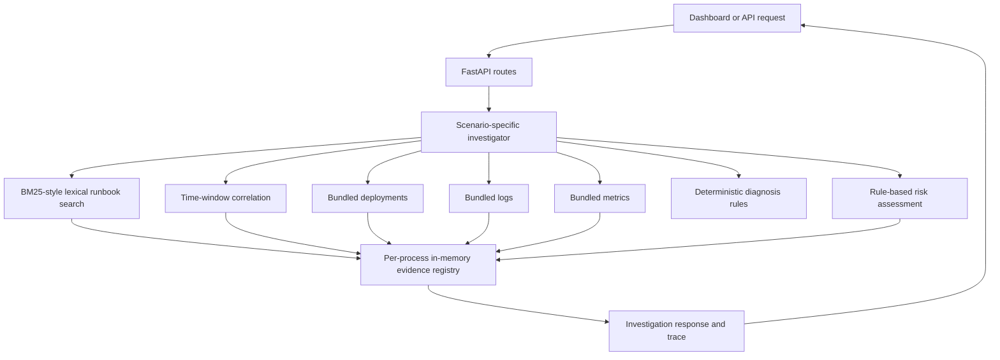

# Pipeline Audit

## Status and scope

This report describes the repository as tested in this work session. It covers the actual FastAPI application, bundled incident fixtures, Markdown runbooks, investigator, six tool methods, evidence registry, correlation logic, benchmark, and browser dashboard. The implementation is a local synthetic-data demo, not a production incident-response service.

## Verified architecture

The application loads 10 incident fixtures and 10 Markdown runbooks in process. There is no model-provider integration, external telemetry connector, database, durable evidence store, or remediation executor. Diagnosis is selected by scenario-oriented Python conditions in `incident_investigator/app/investigator.py`; the baseline is a separate keyword-oriented implementation.

## End-to-end execution

| Stage | Actual behavior and output | Audit result |
|---|---|---|
| Incident selection | The dashboard selects a fixture ID; FastAPI checks it before investigation. Unknown IDs return HTTP 404. | **PASS** |
| Runbook retrieval | Tokenizes the alert, computes BM25-style lexical scores, adds an exact-service boost, returns ranked runbooks. No semantic/vector search. | **PASS** for the curated set |
| Temporal correlation | Filters deployment, log, and metric fixtures to inclusive configurable windows around the incident start; parses timezone-aware timestamps to UTC and sorts the timeline chronologically. Deployments are causal candidates only when they precede the incident. | **PASS** for tested boundaries and offsets |
| Tool queries | Reads the fixture collections; logs, deployments, metrics, and selected runbook results register evidence. Empty collections produce empty results. | **PASS** |
| Root-cause selection | Applies deterministic signal-matching rules and returns a diagnosis/category. This is not an LLM-generated or generally validated RCA. | **PASS** on 10 known fixtures; generalization **NOT TESTED** |
| Risk assessment | Maps fixture categories and severity to fixed threat/CWE/CIA/risk/SLA values. | **PASS** for fixture output; external correctness **NOT TESTED** |
| Report and trace | Returns diagnosis, category, heuristic confidence, evidence chain, mitigation text, risk output, duration, and six tool trace entries. Evidence references in trace resolve to evidence IDs. | **PASS** |

`get_runbook_detail_tool` is called during orchestration but is not its own trace step. The diagnosis object does not contain claim-by-claim evidence citations. The trace and evidence chain provide related artifacts, not proof that each diagnosis sentence is supported.

## Investigation tools

| Tool | Valid execution | Invalid/read-only checks | Evidence behavior | Result |
|---|---|---|---|---|
| `search_runbooks` | Ranked runbook matches returned for fixture alerts. | Empty and irrelevant queries return no matches; selected mutation keywords are rejected. | Captures up to two ranked matches. | **PASS** |
| `correlate_signals` | Returns correlation finding, event counts, and timeline. | Unknown IDs fail; invalid timestamps and negative windows fail. | Captures the correlation result, linked into the trace. | **PASS** |
| `get_deployments` | Returns fixture deployment events. | Unknown IDs fail; selected mutation keywords are rejected. | One evidence item per returned deployment. | **PASS** |
| `query_logs` | Returns matching fixture logs. | Unknown IDs fail; invalid/mutating query terms are rejected. | One evidence item per returned log. | **PASS** |
| `query_metrics` | Returns matching fixture metric points. | Unknown IDs fail; invalid/mutating query terms are rejected. | Timestamp-qualified IDs preserve distinct metric samples. | **PASS** |
| `assess_security_risk` | Returns fixed risk metadata based on incident/category/severity. | Unknown IDs fail; selected mutation keywords are rejected. | Captures one risk item. | **PASS** |

Mutation rejection is a string-pattern check in application code. It is not process isolation, authorization, a shell sandbox, or an infrastructure security boundary. These local fixture tools have no remote call or configurable timeout; timeout behavior is **NOT TESTED** because no external timeout surface exists.

## Retrieval and temporal checks

- **Runbook index:** 10 bundled Markdown files loaded and tokenized. Tokenization lowercases text and retains alphanumeric, underscore, hyphen, and period tokens longer than two characters.
- **Curated retrieval:** the initial-alert/service query for each fixture returned its expected runbook at rank 1 in 10/10 cases. This is a small fixture-specific top-1 check, not a general precision/recall benchmark.
- **Negative retrieval:** empty, irrelevant, and unknown-runbook-ID cases return empty/`None` as appropriate.
- **Time windows:** the regression test checks inclusive boundaries, out-of-window exclusion, offset normalization, chronological ordering, and deployment causality. Invalid, timezone-naive, missing, and negative-window values are rejected.
- **Limitations:** no broad relevance-judgment corpus exists for statistically meaningful retrieval recall; contradictory-signal detection is not implemented.

## Evidence and traceability

- Evidence IDs are constructed from evidence type and source ID. Metric source IDs include service, metric name, and timestamp; tests confirm all seven INC-001 metric samples have distinct IDs.
- The correlation result is now captured as a `CORRELATION` item and referenced by the corresponding trace step.
- All evidence IDs referenced by traces resolve in that investigation's evidence chain; five concurrent investigations were tested and serialized to prevent shared-registry cross-contamination.
- Evidence is mutable in-memory state, cleared at the start of an investigation and not persisted or cryptographically sealed. ID uniqueness is verified for the bundled source records, not guaranteed for arbitrary future sources.
- The `unsupported_claims` list is empty for the investigator fixtures, but its production is not an independent claim-by-claim audit. Treat an empty list as **WARNING**, not proof of grounding.

## API surface exercised

| Method and path | Verified behavior |
|---|---|
| `GET /` | Dashboard serves successfully |
| `GET /api/health`, `/api/stats`, `/api/incidents` | 200 and expected response fields when authenticated if a token is configured |
| `GET /api/healthz`, `/api/readyz` | Generic liveness/readiness response without incident details |
| `GET /api/incidents/{incident_id}` | 200 for known IDs; 404 for unknown |
| `GET /api/evidence` | Returns current investigation evidence; unknown incident returns 404 |
| `GET /api/logs`, `/api/metrics`, `/api/deployments` | 200 for known IDs; missing required query parameters return 422; unknown IDs return 404 |
| `GET /api/runbooks` | Search requires `query`; empty matches are valid |
| `GET /api/runbooks/{runbook_id}` | Known runbook 200; unknown runbook 404 |
| `POST /api/investigate/{incident_id}` | `ai` and `baseline` modes return 200; unknown ID 404; invalid mode 422 |
| `GET /api/trace/{incident_id}` | Known ID 200; unknown ID 404 |
| `GET /api/benchmark`, `/api/benchmark/export` | Both return benchmark output in memory; neither changes `benchmark_results.json` |
| `GET /docs`, `/redoc`, `/openapi.json`, `/static/app.js`, `/static/style.css` | 200 |

Wrong HTTP methods return 405. A malformed JSON body was not applicable to the bodyless investigation endpoint and was not tested. The earlier wildcard CORS configuration has been replaced with an empty-by-default exact-origin allowlist; wildcard origins are rejected and credentials remain disabled.

## Environment notes

- Project virtual environment: Python 3.12.16; FastAPI 0.162.5, Starlette 1.10.0, Pydantic 2.14.3, HTTPX 0.28.1, Uvicorn 0.54.0.
- `pip` is unavailable inside the existing virtual environment, although imports and test execution work.
- `requirements.txt` uses lower-bound version ranges, with no lock file.
- `.env.example` lists supported process environment variables. The Python process does not load `.env` itself; Compose reads `.env` for interpolation.
- Docker CLI was unavailable, so container build and runtime behavior are **BLOCKED**.

See [`QA_TEST_PLAN.md`](./QA_TEST_PLAN.md), [`FINAL_QA_REPORT.md`](./FINAL_QA_REPORT.md), and [`DEPLOYMENT_READINESS.md`](./DEPLOYMENT_READINESS.md) for detailed results and release limitations.

## Production-hardening update (2026-11-12)

- Added production-required bearer-token authentication for API routes; only generic `/api/healthz` and `/api/readyz` probes remain unauthenticated. The detailed `/api/health` route is protected.
- Added startup checks for token length/format, `APP_ENV`, rate-limit values, and exact CORS origins; production CORS origins must use HTTPS.
- Added in-process request rate limiting, request IDs, security response headers, JSON-line request logs that omit raw paths/queries/credentials/payloads, and generic unexpected-error responses.
- Added authenticated aggregate `/api/ops/metrics` with request latency, investigation duration/failure, rate-limit, and tool-failure counters; no incident labels or payloads are exported.
- The dashboard requests a bearer token interactively and escapes dynamic telemetry/result content before inserting HTML.
- Benchmark HTTP routes no longer persist their output.
- Dockerfile/Compose now configure non-root/read-only execution, loopback-only host binding, reduced capabilities, bounded Uvicorn settings, and a generic health check. These are configuration changes only; Docker remains **BLOCKED** until runtime validation.

See [`SECURITY_REVIEW.md`](./SECURITY_REVIEW.md) for residual risks. The shared token has no user identity, role, expiry, or revocation; the limiter is per-process; HTTPS termination, external monitoring, real-data controls, dependency scanning, and Docker runtime validation remain outstanding.
